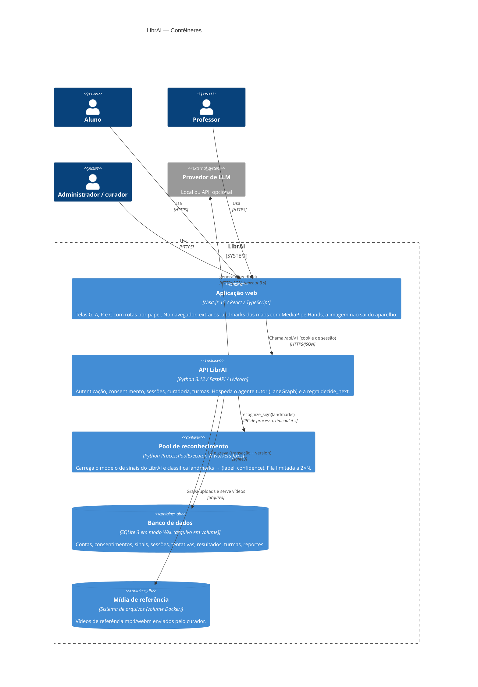
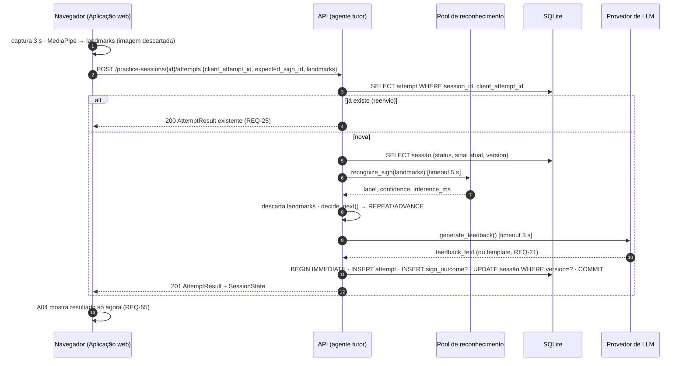

# LibrAI · C4 nível 2 — Contêineres (arc42 §5)

> Unidades executáveis do LibrAI, a tecnologia de cada uma e como se comunicam. "Contêiner", no C4, é uma unidade que executa ou guarda dados — não necessariamente um contêiner Docker (o mapeamento para Docker está na última seção).

## Diagrama

## Contêineres

| Contêiner | Tecnologia | Responsabilidade | Expõe / consome | Decisões | Requisitos-chave |
|---|---|---|---|---|---|
| **Aplicação web** | Next.js 15, React, TypeScript; `@mediapipe/tasks-vision` servido localmente | 18 telas (G01–C04), roteamento por `role`, captura e extração de `landmarks`, estados offline e carregando | Consome `openapi.yaml` | ADR-0002, ADR-0007 | REQ-09, REQ-51, REQ-52, REQ-54, REQ-55, REQ-57 |
| **API LibrAI** | FastAPI, Pydantic v2 (schemas gerados a partir do OpenAPI), LangGraph, Argon2id | Regras de negócio; agente tutor (grafo validar → reconhecer → decidir → redigir → gravar); autorização por papel e posse | Expõe `/api/v1` ([`openapi.yaml`](contratos/openapi.yaml)) | ADR-0001, ADR-0003, ADR-0006, ADR-0008 | REQ-01–REQ-48, REQ-59 |
| **Pool de reconhecimento** | `concurrent.futures.ProcessPoolExecutor` com `RECOGNIZER_WORKERS` (padrão: nº de núcleos − 1) | Inferência em CPU isolada do laço de eventos da API; recusa trabalho além da fila | `recognize_sign` ([`ferramentas-agente.md`](contratos/ferramentas-agente.md)) | ADR-0004 | REQ-16, REQ-27, REQ-28, REQ-50 |
| **Banco de dados** | SQLite 3, `journal_mode=WAL`, `busy_timeout=5000` | Persistência transacional e invariantes (índices únicos parciais) | [`modelo-dados.md`](contratos/modelo-dados.md) | ADR-0005 | REQ-15, REQ-25, REQ-30, REQ-43 |
| **Mídia de referência** | Diretório em volume; nome do arquivo = `reference_media.id` | Guardar e servir vídeos de referência (nunca vídeo de aluno) | `GET /media/{id}` estático via API | — | REQ-41, REQ-44 |

## Fluxo principal: uma tentativa (A03 → A04)

## Mapeamento para implantação (Docker Compose)

| Serviço Docker | Contêineres C4 | Volume |
|---|---|---|
| `web` | Aplicação web | — |
| `api` | API LibrAI + Pool de reconhecimento (mesmo contêiner Docker, processos separados) | `librai-data:/data` (`librai.db` + `media/`) |

Um único host, sem GPU (FI-01 §10.3). O primeiro administrador é criado no contêiner `api` pelo comando `python -m librai.create_admin` (antes de existir C04). O LLM local, quando houver, roda fora do Compose e é configurado por `LIBRAI_LLM_URL`.
