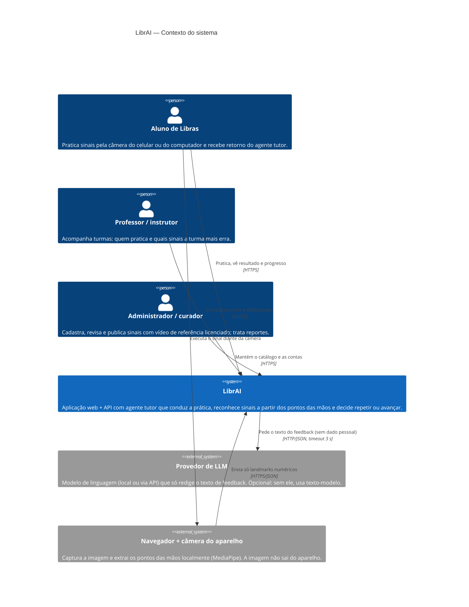

# LibrAI · C4 nível 1 — Contexto do sistema (arc42 §3)

> Mostra o LibrAI como uma caixa só, quem o usa e com quais sistemas externos ele conversa. Define os **limites e vizinhos** que viram o escopo do `PROJECT.md` e os `boundaries` dos planos do PAUL.

## Diagrama

## Elementos

| Elemento | Tipo | Responsabilidade | Interface | Requisitos |
|---|---|---|---|---|
| **Aluno** | pessoa | Praticar, ver resultado e progresso, estudar e reportar sinais, entrar em turma | Telas A01–A08 | REQ-08–REQ-36 |
| **Professor** | pessoa | Criar turmas e acompanhar agregados de desempenho | Telas P01–P04 | REQ-37–REQ-40 |
| **Administrador / curador** | pessoa | Curadoria do catálogo, reportes e contas | Telas C01–C04 | REQ-41–REQ-48, REQ-59 |
| **LibrAI** | sistema (escopo) | Tudo o que está em [`c4-conteineres.md`](c4-conteineres.md) | [`contratos/openapi.yaml`](contratos/openapi.yaml) | todos |
| **Provedor de LLM** | sistema externo | Redigir `feedback_text` | `generate_feedback` ([`ferramentas-agente.md`](contratos/ferramentas-agente.md)) | REQ-20, REQ-21 |
| **Navegador + câmera** | ambiente externo | Captura e extração de `landmarks` no aparelho | `getUserMedia` + MediaPipe Hands | REQ-09 |

## Limites (o que está dentro e fora)

**Dentro do LibrAI:** contas e papéis, consentimento, catálogo e curadoria, sessão de prática, agente tutor, reconhecimento (classificação dos `landmarks`), persistência, métricas de latência, turmas e agregados para o professor.

**Fora do LibrAI (vizinhos):**
- **Provedor de LLM** — não é dependência crítica: se cair ou demorar mais de 3 s, o feedback vem do texto-modelo (REQ-21). O projeto continua funcionando sem ele (`LIBRAI_LLM_PROVIDER=none`).
- **Navegador do usuário** — a extração de pontos roda nele; o LibrAI fornece o código e o modelo MediaPipe como arquivos estáticos próprios (sem CDN de terceiros em tempo de execução, para que nenhuma requisição revele o uso da câmera).
- **Sem** integração com sistemas acadêmicos (SIGAA, Moodle), login social ou envio de e-mail no escopo atual — contas de professor são criadas pelo administrador (REQ-59).
- **Sem** fonte de dados externa em tempo de execução (FI-01 §10.4): os vídeos de referência são enviados pelo curador.

## Partes afetadas que não aparecem no diagrama

Comunidade surda, pessoas filmadas nas referências e produtores de material (FI-01 §3.2) não operam o sistema. Os efeitos sobre elas são tratados por requisitos — `regional_variant` e `source_credit` sempre visíveis (REQ-34), canal de reporte (REQ-35) e licença e consentimento para publicar (REQ-41) — e estão em [`metas-e-restricoes.md`](metas-e-restricoes.md) §1.4.
