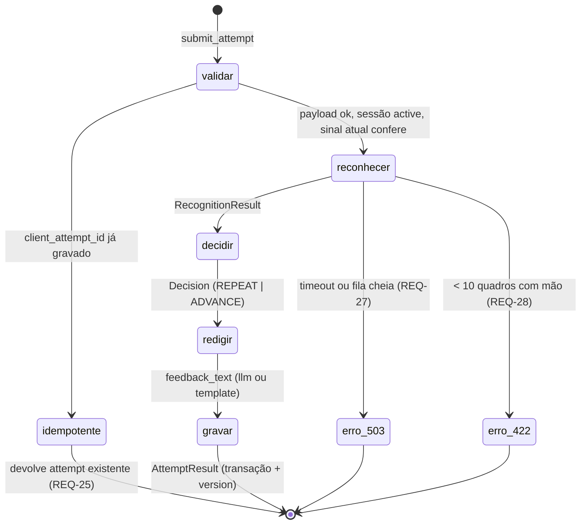

# LibrAI · Contratos internos do agente tutor

> Contratos **dentro** da API: as ferramentas que o grafo LangGraph do agente tutor chama ([ADR-0006](../adr/0006-orquestrar-tutor-com-langgraph-na-api.md)). Não são expostos por HTTP; são invocados por `submit_attempt` ([`openapi.yaml`](openapi.yaml)). Assinaturas em Python com tipos — viram os `files`/`verify` das tasks do PAUL.

## 1. Grafo do agente tutor (uma tentativa)



Estado do grafo (`TutorState`):

```python
class TutorState(TypedDict):
    session_id: str
    student_id: str
    expected_sign_id: str
    expected_label: str           # sign.recognizer_label do sinal atual
    attempt_number: int           # tentativas já gravadas para o sinal + 1
    max_attempts_per_sign: int    # da practice_session
    confidence_threshold: float   # da practice_session
    session_version: int          # lido no início; conferido no gravar (ADR-0003)
    landmarks: Landmarks          # descartado após `reconhecer` (REQ-11)
    recognition: RecognitionResult | None
    decision: Decision | None
    feedback: Feedback | None
```

## 2. `recognize_sign` — ferramenta de reconhecimento

```python
def recognize_sign(landmarks: Landmarks) -> RecognitionResult: ...

@dataclass(frozen=True)
class RecognitionResult:
    label: str | None        # rótulo do modelo; None se nenhum rótulo superar 0,0 após softmax
    confidence: float        # 0..1, probabilidade do rótulo devolvido
    model_version: str       # ex.: "librai-hands-2026.10"
    inference_ms: int
```

| Aspecto | Contrato |
|---|---|
| Modelo | O classificador **já existente** do LibrAI (`models/librai_rf.joblib`): Random Forest do scikit-learn sobre os 21 pontos de **uma** mão por quadro, treinado com letras estáticas do alfabeto manual, mão esquerda e palma voltada para a câmera |
| Algoritmo | (1) seleciona os quadros com mão detectada; (2) se `handedness = Right`, espelha o eixo x (`x → 1 − x`) para equivaler à mão esquerda do treino; (3) normaliza os pontos como no `collect.py`/`train.py` do LibrAI; (4) aplica `predict_proba` em cada quadro; (5) `label` = classe com maior probabilidade média entre os quadros; `confidence` = essa probabilidade média. A média sobre os quadros dá estabilidade ao reconhecimento de um sinal estático mantido por cerca de 3 s |
| Execução | Em processo do pool de tamanho fixo (`RECOGNIZER_WORKERS`), via `asyncio.wait_for(..., timeout=5)` ([ADR-0004](../adr/0004-isolar-inferencia-em-pool-de-processos.md)) |
| Pré-condição | ≥ `MIN_HAND_FRAMES` (10) quadros com ao menos uma mão; senão levanta `NoHandDetected` → `no_hand_detected` 422 (REQ-28) |
| Erros | `RecognizerBusy` (fila no `RECOGNIZER_QUEUE_LIMIT`) e `RecognizerTimeout` → `recognizer_unavailable` 503 (REQ-27) |
| Efeitos colaterais | Nenhum. Não grava, não registra `landmarks` em log (REQ-11) |
| Substituto de teste | `FakeRecognizer(label, confidence)` determinístico — primeira fatia do FI-01 §11 |
| Requisitos | REQ-16, REQ-27, REQ-28, REQ-49 |

## 3. `decide_next` — regra de decisão (determinística)

```python
def decide_next(
    expected_label: str,
    recognition: RecognitionResult,
    attempt_number: int,
    max_attempts_per_sign: int,
    confidence_threshold: float,
) -> Decision: ...

@dataclass(frozen=True)
class Decision:
    decision: Literal["REPEAT", "ADVANCE"]
    decision_reason: Literal["correct", "wrong_sign", "low_confidence", "max_attempts_reached"]
    outcome: Literal["mastered", "not_mastered"] | None   # preenchido só em ADVANCE
```

Tabela de decisão (função pura, sem LLM — [ADR-0001](../adr/0001-decidir-por-regra-deterministica.md)):

| # | `recognition.label == expected_label` | `confidence ≥ threshold` | `attempt_number ≥ max` | `decision` | `decision_reason` | `outcome` | Req. |
|---|---|---|---|---|---|---|---|
| 1 | sim | sim | qualquer | `ADVANCE` | `correct` | `mastered` | REQ-17 |
| 2 | não | qualquer | não | `REPEAT` | `wrong_sign` | — | REQ-18 |
| 3 | sim | não | não | `REPEAT` | `low_confidence` | — | REQ-18 |
| 4 | não, ou sim com confiança baixa | — | sim | `ADVANCE` | `max_attempts_reached` | `not_mastered` | REQ-19 |

## 4. `generate_feedback` — redação do retorno (LLM com fallback)

```python
async def generate_feedback(
    gloss: str,
    decision: Decision,
    recognized_gloss: str | None,
    attempt_number: int,
    max_attempts_per_sign: int,
) -> Feedback: ...

@dataclass(frozen=True)
class Feedback:
    text: str                                # ≤ 280 caracteres, pt-BR
    source: Literal["llm", "template"]
```

| Aspecto | Contrato |
|---|---|
| Entrada ao LLM | Só `gloss`, `decision`, `decision_reason`, `recognized_gloss`, `attempt_number`, `max_attempts_per_sign`. **Sem** dado pessoal, sem `landmarks`, sem nome do aluno |
| Saída | Texto livre truncado a 280 caracteres; o LLM **não** devolve nem altera `decision` (REQ-20) |
| Tempo-limite | `LLM_TIMEOUT` = 3 s → fallback (REQ-21) |
| Fallback | Template por `decision_reason`: `correct` → "Isso! Você fez {gloss}." · `wrong_sign` → "Parece que saiu {recognized_gloss}. Confira a referência de {gloss} e tente de novo." · `low_confidence` → "Quase lá — tente de novo com as mãos bem no centro do quadro." · `max_attempts_reached` → "Vamos seguir e voltar a {gloss} depois." |
| Configuração | `LIBRAI_LLM_PROVIDER` = `none` \| `local` \| `api`; com `none`, sempre template (permite rodar sem LLM e nos testes) |
| Requisitos | REQ-20, REQ-21 |

## 5. `record_attempt` — gravação atômica

```python
def record_attempt(conn, state: TutorState, now: datetime) -> AttemptResult: ...
```

Numa única transação `BEGIN IMMEDIATE` (REQ-30):

1. `INSERT INTO attempt (...)` — `UNIQUE(session_id, client_attempt_id)` barra a duplicata (REQ-25);
2. se `ADVANCE`: `INSERT INTO sign_outcome (...)` (REQ-53);
3. `UPDATE practice_session SET current_position = ?, status = ?, finished_at = ?, version = version + 1 WHERE id = ? AND version = ?` — se 0 linhas forem afetadas, `ROLLBACK` e o fluxo recarrega o estado:
   - se a tentativa com esse `client_attempt_id` já existe → devolve-a (REQ-25);
   - se o sinal atual mudou → `stale_sign` (REQ-26);
   - se o sinal atual é o mesmo (outra tentativa do mesmo sinal gravou antes) → refaz `decide_next` com o `attempt_number` atualizado, **reaproveitando o `RecognitionResult`**, e tenta gravar de novo, até 3 vezes; depois disso, `recognizer_unavailable` (503) com `Retry-After: 1`.

`UNIQUE (session_id, sign_id, attempt_number)` é a segunda barreira: duas tentativas simultâneas nunca recebem o mesmo número.
