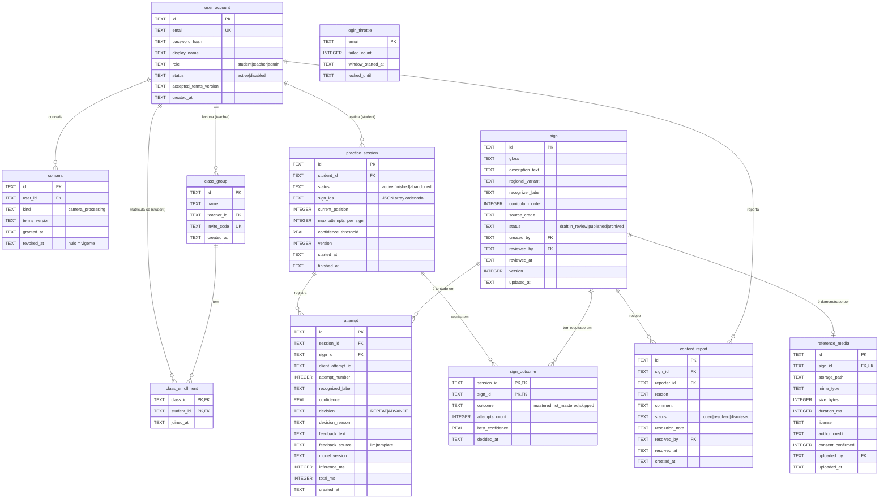

# LibrAI · Modelo de dados

> Fonte dos nomes de campo usados nas telas e no [`openapi.yaml`](openapi.yaml). Banco: **SQLite 3 em modo WAL** ([ADR-0005](../adr/0005-usar-sqlite-em-modo-wal.md)). Ids são UUID v4 guardados como `TEXT`; datas em ISO 8601 UTC (`TEXT`).

## 1. Diagrama entidade-relacionamento



## 2. Entidades

| Entidade | Para que serve | Telas | Requisitos |
|---|---|---|---|
| `user_account` | Conta e papel (`student`, `teacher`, `admin`) | G01, G02, C04 | REQ-01–REQ-07, REQ-47, REQ-59 |
| `login_throttle` | Contagem de falhas de login por e-mail | G01 | REQ-03 |
| `consent` | Consentimento de processamento da câmera, versionado e revogável | A02 | REQ-08, REQ-12 |
| `class_group` | Turma do professor e código de convite | P01, A08 | REQ-37, REQ-38 |
| `class_enrollment` | Vínculo aluno ↔ turma | A08, P02 | REQ-36 |
| `sign` | Sinal do catálogo e seu ciclo de curadoria | A03, A07, C01, C02 | REQ-13, REQ-33, REQ-34, REQ-41–REQ-45, REQ-48 |
| `reference_media` | Vídeo de referência com licença e consentimento de quem aparece nele | A03, A07, C02 | REQ-41, REQ-44 |
| `practice_session` | Sessão de prática e estado do agente tutor (sinal atual, versão) | A01, A03, A04, A05 | REQ-13–REQ-15, REQ-22, REQ-24, REQ-29, REQ-30, REQ-58 |
| `attempt` | Uma tentativa avaliada: **só o resultado**, nunca a captura | A04, P03 | REQ-11, REQ-16–REQ-21, REQ-25, REQ-49 |
| `sign_outcome` | Resultado final de um sinal numa sessão | A05, A06, P02–P04 | REQ-17, REQ-19, REQ-23, REQ-31, REQ-40, REQ-53 |
| `content_report` | Reporte de aluno sobre um sinal | A07, C03 | REQ-35, REQ-46 |

## 3. DDL (SQLite)

```sql
PRAGMA journal_mode = WAL;
PRAGMA foreign_keys = ON;

CREATE TABLE user_account (
  id                      TEXT PRIMARY KEY,
  email                   TEXT NOT NULL UNIQUE COLLATE NOCASE,
  password_hash           TEXT NOT NULL,                       -- Argon2id (REQ-06)
  display_name            TEXT NOT NULL CHECK (length(display_name) BETWEEN 2 AND 60),
  role                    TEXT NOT NULL CHECK (role IN ('student','teacher','admin')),
  status                  TEXT NOT NULL DEFAULT 'active' CHECK (status IN ('active','disabled')),
  accepted_terms_version  TEXT,
  created_at              TEXT NOT NULL
);

CREATE TABLE login_throttle (
  email              TEXT PRIMARY KEY COLLATE NOCASE,
  failed_count       INTEGER NOT NULL DEFAULT 0,
  window_started_at  TEXT NOT NULL,
  locked_until       TEXT
);

CREATE TABLE consent (
  id             TEXT PRIMARY KEY,
  user_id        TEXT NOT NULL REFERENCES user_account(id),
  kind           TEXT NOT NULL CHECK (kind IN ('camera_processing')),
  terms_version  TEXT NOT NULL,
  granted_at     TEXT NOT NULL,
  revoked_at     TEXT
);
-- no máximo um consentimento vigente por tipo
CREATE UNIQUE INDEX ux_consent_active ON consent(user_id, kind) WHERE revoked_at IS NULL;

CREATE TABLE class_group (
  id           TEXT PRIMARY KEY,
  name         TEXT NOT NULL CHECK (length(name) BETWEEN 3 AND 80),
  teacher_id   TEXT NOT NULL REFERENCES user_account(id),
  invite_code  TEXT NOT NULL UNIQUE COLLATE NOCASE,            -- REQ-38
  created_at   TEXT NOT NULL
);

CREATE TABLE class_enrollment (
  class_id    TEXT NOT NULL REFERENCES class_group(id),
  student_id  TEXT NOT NULL REFERENCES user_account(id),
  joined_at   TEXT NOT NULL,
  PRIMARY KEY (class_id, student_id)                            -- REQ-36: sem duplicar
);

CREATE TABLE sign (
  id                TEXT PRIMARY KEY,
  gloss             TEXT NOT NULL CHECK (gloss = upper(gloss)),
  description_text  TEXT,
  regional_variant  TEXT NOT NULL,
  recognizer_label  TEXT NOT NULL,
  curriculum_order  INTEGER NOT NULL CHECK (curriculum_order >= 1),
  source_credit     TEXT NOT NULL,
  status            TEXT NOT NULL DEFAULT 'draft'
                    CHECK (status IN ('draft','in_review','published','archived')),
  created_by        TEXT NOT NULL REFERENCES user_account(id),
  reviewed_by       TEXT REFERENCES user_account(id),
  reviewed_at       TEXT,
  version           INTEGER NOT NULL DEFAULT 0,                 -- REQ-43
  updated_at        TEXT NOT NULL
);
CREATE INDEX ix_sign_published_order ON sign(status, curriculum_order);

CREATE TABLE reference_media (
  id                 TEXT PRIMARY KEY,
  sign_id            TEXT NOT NULL UNIQUE REFERENCES sign(id),  -- uma referência vigente por sinal
  storage_path       TEXT NOT NULL,
  mime_type          TEXT NOT NULL CHECK (mime_type IN ('video/mp4','video/webm')),
  size_bytes         INTEGER NOT NULL CHECK (size_bytes <= 52428800),
  duration_ms        INTEGER,
  license            TEXT NOT NULL,
  author_credit      TEXT NOT NULL,
  consent_confirmed  INTEGER NOT NULL CHECK (consent_confirmed IN (0,1)),
  uploaded_by        TEXT NOT NULL REFERENCES user_account(id),
  uploaded_at        TEXT NOT NULL
);

CREATE TABLE practice_session (
  id                     TEXT PRIMARY KEY,
  student_id             TEXT NOT NULL REFERENCES user_account(id),
  status                 TEXT NOT NULL CHECK (status IN ('active','finished','abandoned')),
  sign_ids               TEXT NOT NULL,                         -- JSON: ["uuid", ...] na ordem da sessão
  current_position       INTEGER NOT NULL DEFAULT 0,
  max_attempts_per_sign  INTEGER NOT NULL,                      -- cópia da config (REQ-13)
  confidence_threshold   REAL NOT NULL,                         -- cópia da config (REQ-13)
  version                INTEGER NOT NULL DEFAULT 0,            -- ADR-0003
  started_at             TEXT NOT NULL,
  finished_at            TEXT
);
-- REQ-15: no máximo uma sessão ativa por aluno
CREATE UNIQUE INDEX ux_session_one_active ON practice_session(student_id) WHERE status = 'active';

CREATE TABLE attempt (
  id                 TEXT PRIMARY KEY,
  session_id         TEXT NOT NULL REFERENCES practice_session(id),
  sign_id            TEXT NOT NULL REFERENCES sign(id),
  client_attempt_id  TEXT NOT NULL,
  attempt_number     INTEGER NOT NULL CHECK (attempt_number >= 1),
  recognized_label   TEXT,
  confidence         REAL NOT NULL CHECK (confidence BETWEEN 0 AND 1),
  decision           TEXT NOT NULL CHECK (decision IN ('REPEAT','ADVANCE')),
  decision_reason    TEXT NOT NULL
                     CHECK (decision_reason IN ('correct','wrong_sign','low_confidence','max_attempts_reached')),
  feedback_text      TEXT NOT NULL CHECK (length(feedback_text) <= 280),
  feedback_source    TEXT NOT NULL CHECK (feedback_source IN ('llm','template')),
  model_version      TEXT NOT NULL,
  inference_ms       INTEGER NOT NULL,                          -- REQ-49
  total_ms           INTEGER NOT NULL,                          -- REQ-49
  created_at         TEXT NOT NULL,
  UNIQUE (session_id, client_attempt_id),                       -- REQ-25 (idempotência)
  UNIQUE (session_id, sign_id, attempt_number)                  -- nunca duas tentativas com o mesmo número
);
-- Não existe coluna para landmarks, imagem ou vídeo: REQ-11 é garantido pelo schema.

CREATE TABLE sign_outcome (
  session_id       TEXT NOT NULL REFERENCES practice_session(id),
  sign_id          TEXT NOT NULL REFERENCES sign(id),
  outcome          TEXT NOT NULL CHECK (outcome IN ('mastered','not_mastered','skipped')),
  attempts_count   INTEGER NOT NULL,
  best_confidence  REAL,
  decided_at       TEXT NOT NULL,
  PRIMARY KEY (session_id, sign_id)                             -- um resultado por sinal por sessão
);

CREATE TABLE content_report (
  id               TEXT PRIMARY KEY,
  sign_id          TEXT NOT NULL REFERENCES sign(id),
  reporter_id      TEXT NOT NULL REFERENCES user_account(id),
  reason           TEXT NOT NULL
                   CHECK (reason IN ('incorrect_execution','regional_variant','inappropriate','other')),
  comment          TEXT CHECK (comment IS NULL OR length(comment) <= 500),
  status           TEXT NOT NULL DEFAULT 'open' CHECK (status IN ('open','resolved','dismissed')),
  resolution_note  TEXT,
  resolved_by      TEXT REFERENCES user_account(id),
  resolved_at      TEXT,
  created_at       TEXT NOT NULL,
  CHECK (status = 'open' OR resolution_note IS NOT NULL)        -- REQ-46
);
-- REQ-35: um reporte aberto por aluno por sinal
CREATE UNIQUE INDEX ux_report_one_open ON content_report(sign_id, reporter_id) WHERE status = 'open';
```

## 4. Decisões de modelagem

1. **A tentativa guarda o resultado, nunca a captura.** A tabela `attempt` não tem coluna para `landmarks`, imagem ou vídeo; a garantia de REQ-11 está no schema, não só no código. O professor vê agregados disso (REQ-39). Ver [ADR-0002](../adr/0002-extrair-landmarks-no-navegador.md).
2. **Configuração copiada para a sessão.** `confidence_threshold` e `max_attempts_per_sign` são copiados para `practice_session` no início (REQ-13). Quando o limiar provisório mudar depois do baseline, sessões antigas continuam explicáveis: a decisão de cada `attempt` pode ser recalculada com os valores da própria sessão.
3. **Invariantes de concorrência no banco.** O índice parcial `ux_session_one_active` (REQ-15), o `UNIQUE (session_id, client_attempt_id)` (REQ-25) e a coluna `version` (ADR-0003) fazem o banco recusar estados inválidos mesmo se o código errar.
4. **`sign_ids` como JSON ordenado.** A ordem da sessão é fixada na criação; arquivar um sinal depois não altera sessões em andamento (REQ-45). Sessões têm de 5 a 10 sinais, então não precisam de tabela de junção.
5. **`not_reached` não é gravado.** É derivado no resumo: está em `sign_ids` e não tem `sign_outcome` (REQ-31).

## 5. Retenção (LGPD)

| Dado | Retenção | Motivo |
|---|---|---|
| Quadros da câmera | **nunca saem do navegador** | ADR-0002 |
| `landmarks` | só na memória durante a inferência (< 5 s) | REQ-11 |
| `attempt`, `sign_outcome`, `practice_session` | enquanto a conta existir; apagados em cascata se o aluno pedir exclusão | base do progresso (REQ-31, REQ-32) |
| `consent` | 5 anos após `revoked_at` | prova do consentimento (LGPD art. 8º, §2º) |
| `reference_media` | enquanto o sinal existir; removida se o titular da imagem retirar a autorização | consentimento de quem aparece no vídeo (FI-01 §3.2) |
