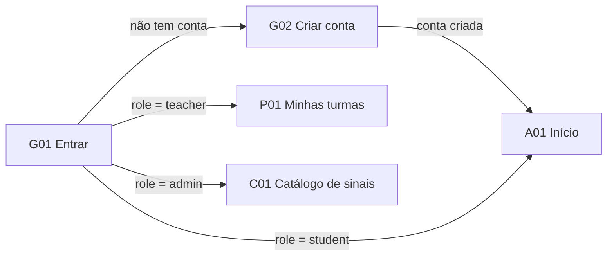
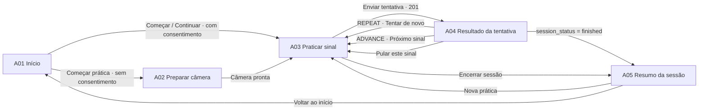
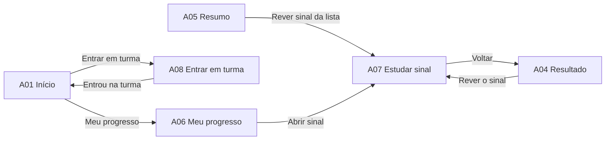
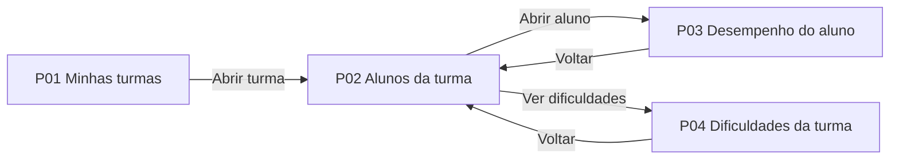
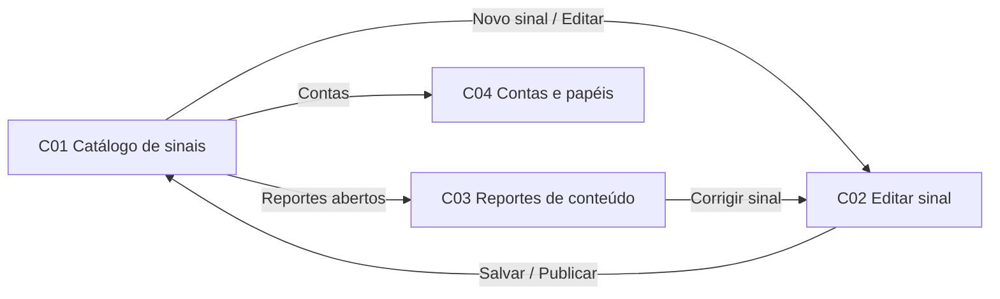

# LibrAI · Inventário e navegação

> Camada 2 da especificação de telas. Cada id é **estável**: é citado na ficha da tela, em [`requisitos.md`](../arquitetura/requisitos.md) e na [matriz de rastreabilidade](../arquitetura/rastreabilidade.md).

## 1. Superfícies e atores

| Código | Superfície | Plataforma | Atores |
|---|---|---|---|
| **G** | Acesso | Web responsiva | aluno, professor, administrador |
| **A** | App do aluno | Web responsiva, celular primeiro | aluno |
| **P** | Painel do professor | Web, desktop/tablet | professor |
| **C** | Console de curadoria | Web, desktop | administrador / curador |

## 2. Quadro de telas

| ID | Tela | Ator | Superfície | Fluxo principal | MVP? | Ficha |
|---|---|---|---|---|---|---|
| G01 | Entrar | todos | Acesso | Autenticação | Sim | [G01-entrar.md](G01-entrar.md) |
| G02 | Criar conta | aluno | Acesso | Autenticação | Sim | [G02-criar-conta.md](G02-criar-conta.md) |
| A01 | Início | aluno | App do aluno | Prática guiada | Sim | [A01-inicio.md](A01-inicio.md) |
| A02 | Preparar câmera | aluno | App do aluno | Prática guiada | Sim | [A02-preparar-camera.md](A02-preparar-camera.md) |
| A03 | Praticar sinal | aluno | App do aluno | Prática guiada | Sim | [A03-praticar-sinal.md](A03-praticar-sinal.md) |
| A04 | Resultado da tentativa | aluno | App do aluno | Prática guiada | Sim | [A04-resultado-tentativa.md](A04-resultado-tentativa.md) |
| A05 | Resumo da sessão | aluno | App do aluno | Prática guiada | Sim | [A05-resumo-sessao.md](A05-resumo-sessao.md) |
| A06 | Meu progresso | aluno | App do aluno | Progresso | Não (feature 5) | [A06-meu-progresso.md](A06-meu-progresso.md) |
| A07 | Estudar sinal | aluno | App do aluno | Estudo e reporte | Sim | [A07-estudar-sinal.md](A07-estudar-sinal.md) |
| A08 | Entrar em turma | aluno | App do aluno | Turmas | Não | [A08-entrar-turma.md](A08-entrar-turma.md) |
| P01 | Minhas turmas | professor | Painel do professor | Acompanhamento | Não | [P01-minhas-turmas.md](P01-minhas-turmas.md) |
| P02 | Alunos da turma | professor | Painel do professor | Acompanhamento | Não | [P02-alunos-turma.md](P02-alunos-turma.md) |
| P03 | Desempenho do aluno | professor | Painel do professor | Acompanhamento | Não | [P03-desempenho-aluno.md](P03-desempenho-aluno.md) |
| P04 | Dificuldades da turma | professor | Painel do professor | Acompanhamento | Não | [P04-dificuldades-turma.md](P04-dificuldades-turma.md) |
| C01 | Catálogo de sinais | administrador | Console de curadoria | Curadoria | Sim (mínimo) | [C01-catalogo-sinais.md](C01-catalogo-sinais.md) |
| C02 | Editar sinal | administrador | Console de curadoria | Curadoria | Sim (mínimo) | [C02-editar-sinal.md](C02-editar-sinal.md) |
| C03 | Reportes de conteúdo | administrador | Console de curadoria | Curadoria | Não | [C03-reportes-conteudo.md](C03-reportes-conteudo.md) |
| C04 | Contas e papéis | administrador | Console de curadoria | Administração | Não | [C04-contas-papeis.md](C04-contas-papeis.md) |

**18 telas**, sendo 2 de infraestrutura (G01, G02) e 16 de fluxos principais.

> **Sobre "MVP?"** — O trabalho pede o **sistema completo** do grupo; a coluna só registra o que o FI-01 colocou na fatia mínima. C01/C02 entram no MVP em versão mínima porque, sem catálogo publicado, não há sinal para praticar (REQ-14). As telas de professor e de turma correspondem ao "dashboard para professores", declarado fora do MVP no FI-01 §5, e são especificadas aqui para o grupo consolidar.

## 3. Mapa de navegação

### 3.1 Entrada e roteamento por papel

### 3.2 Prática guiada (fluxo central do aluno)

Sequência típica: **A01 → A02 → A03 → A04 → A03 → A04 → … → A05 → A01**.

### 3.3 Estudo, progresso e turma (aluno)

### 3.4 Acompanhamento (professor)

Sequência típica: **P01 → P02 → P03** e **P01 → P02 → P04**.

### 3.5 Curadoria e administração

Sequência típica: **C01 → C02 → C01** e **C03 → C02 → C03**.

## 4. Cobertura

### 4.1 Atores × telas

| Ator | Telas | Fluxos cobertos |
|---|---|---|
| Aluno | G01, G02, A01–A08 | criar conta, entrar, consentir com a câmera, praticar com o agente, ver resultado, pular, encerrar, ver resumo, estudar sinal, reportar sinal, ver progresso, entrar em turma |
| Professor | G01, P01–P04 | entrar, criar turma e compartilhar código, ver alunos, ver desempenho individual, ver dificuldades recorrentes |
| Administrador | G01, C01–C04 | entrar, cadastrar e revisar sinais, enviar referência com licença, publicar e arquivar, tratar reportes, criar contas de professor e de administrador |

### 4.2 Superfícies × telas

| Superfície | Telas |
|---|---|
| Acesso | G01, G02 |
| App do aluno | A01–A08 |
| Painel do professor | P01–P04 |
| Console de curadoria | C01–C04 |

### 4.3 Features do FI-01 × telas

| # | Feature (FI-01 §4.2) | Telas |
|---|---|---|
| 1 | Sessão guiada em que um agente apresenta sinais para prática | A01, A03 |
| 2 | Reconhecimento de um conjunto reduzido de sinais pela câmera | A02, A03 |
| 3 | Retorno ao aluno sobre o resultado da tentativa | A04, A05 |
| 4 | Escolha entre repetir a tentativa ou seguir para o próximo sinal | A04 |
| 5 | Histórico, personalização e acompanhamento de progresso | A06, P02, P03, P04 |
| — | Cadastro e revisão de sinais, materiais de referência e correção de conteúdo (FI-01 §3.1, curador) | C01, C02, C03 |
| — | Contas com permissões específicas (FI-01 §3.1, autenticação) | G01, G02, C04 |
